<!-- Perfil gerado a partir de SVGs (tools/gera.mjs). Edite os textos em tools/gera.mjs e rode: node tools/gera.mjs -->

<picture>
  <source media="(prefers-color-scheme: light)" srcset="./assets/banner-light.svg">
  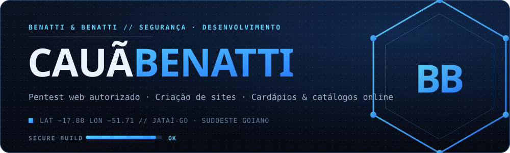
</picture>

<picture>
  <source media="(prefers-color-scheme: light)" srcset="./assets/terminal-light.svg">
  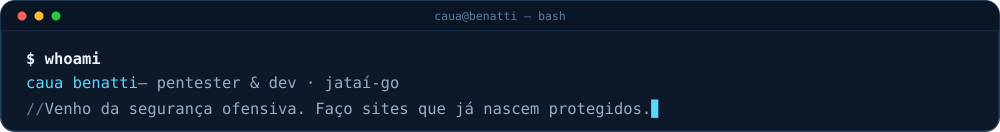
</picture>

  

<a href="https://github.com/Benatti-creator"><picture><source media="(prefers-color-scheme: light)" srcset="./assets/btn-github-light.svg"></picture></a>&nbsp;
<picture><source media="(prefers-color-scheme: light)" srcset="./assets/btn-whatsapp-light.svg"></picture>&nbsp;
<picture><source media="(prefers-color-scheme: light)" srcset="./assets/btn-email-light.svg">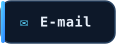</picture>

 

<picture>
  <source media="(prefers-color-scheme: light)" srcset="./assets/sec-sobre-light.svg">
  
</picture>

<picture>
  <source media="(prefers-color-scheme: light)" srcset="./assets/sobre-light.svg">
  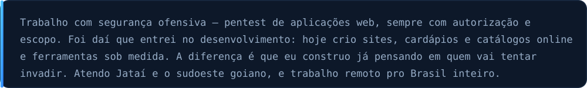
</picture>

  

<picture>
  <source media="(prefers-color-scheme: light)" srcset="./assets/sec-servicos-light.svg">
  
</picture>

<picture>
  <source media="(prefers-color-scheme: light)" srcset="./assets/servicos-light.svg">
  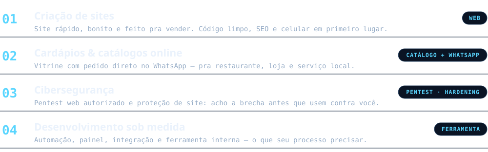
</picture>

  

<picture>
  <source media="(prefers-color-scheme: light)" srcset="./assets/sec-stack-light.svg">
  
</picture>

<picture>
  <source media="(prefers-color-scheme: light)" srcset="./assets/stack-light.svg">
  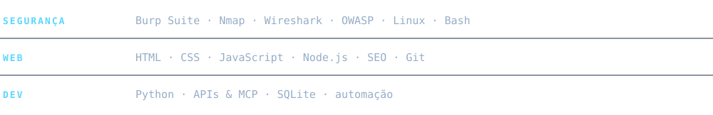
</picture>

  

<picture>
  <source media="(prefers-color-scheme: light)" srcset="./assets/sec-trabalhos-light.svg">
  
</picture>

<a href="https://benatti-creator.github.io/previas/iplanet-store/"><picture><source media="(prefers-color-scheme: light)" srcset="./assets/card-iplanet-light.svg">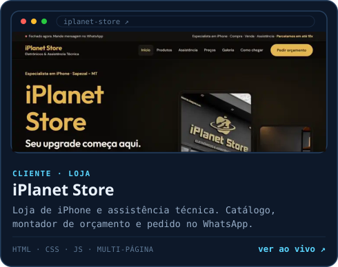</picture></a>
<a href="https://benatti-creator.github.io/previas/isabella-ribeiro-biomedica/"><picture><source media="(prefers-color-scheme: light)" srcset="./assets/card-isabella-light.svg">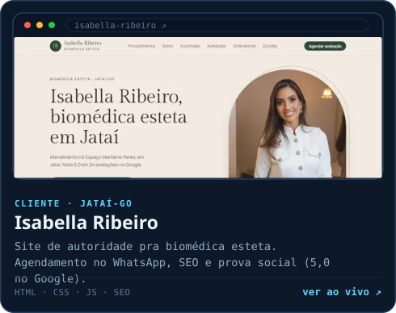</picture></a>

<a href="https://benatti-creator.github.io/previas/jatahy-dreams-eventos/"><picture><source media="(prefers-color-scheme: light)" srcset="./assets/card-jatahy-light.svg">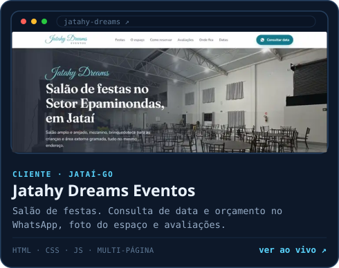</picture></a>

 

<picture>
  <source media="(prefers-color-scheme: light)" srcset="./assets/sec-seguranca-light.svg">
  
</picture>

<picture>
  <source media="(prefers-color-scheme: light)" srcset="./assets/seguranca-light.svg">
  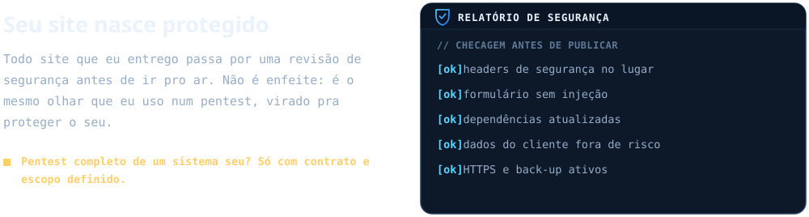
</picture>

  

<picture>
  <source media="(prefers-color-scheme: light)" srcset="./assets/sec-contato-light.svg">
  
</picture>

<picture>
  <source media="(prefers-color-scheme: light)" srcset="./assets/contato-light.svg">
  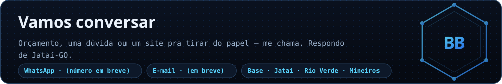
</picture>

  

<picture>
  <source media="(prefers-color-scheme: light)" srcset="./assets/rodape-light.svg">
  
</picture>
