<!-- Perfil no visual do portfólio Terra // Código (benatti-creator.github.io/terra-codigo).
     As imagens saem de tools/perfil.html: edite lá e rode `node tools/gerar.cjs`. -->

<a href="https://benatti-creator.github.io/terra-codigo/">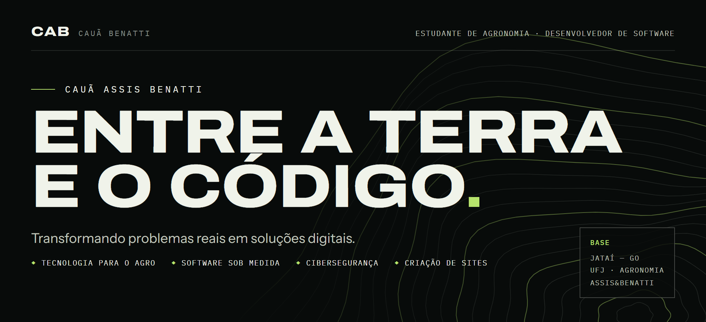</a>

  

<a href="https://benatti-creator.github.io/terra-codigo/">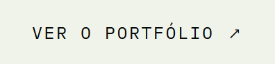</a>&nbsp;<a href="https://wa.me/5564999427458?text=Ol%C3%A1%2C%20Cau%C3%A3!%20Vi%20seu%20GitHub%20e%20queria%20conversar%20sobre%20um%20projeto.">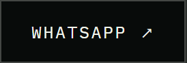</a>&nbsp;<a href="mailto:cauaab505@gmail.com?subject=Contato%20pelo%20GitHub">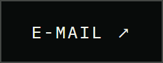</a>

 

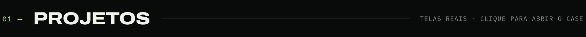

<a href="https://benatti-creator.github.io/terra-codigo/projetos/lavra/">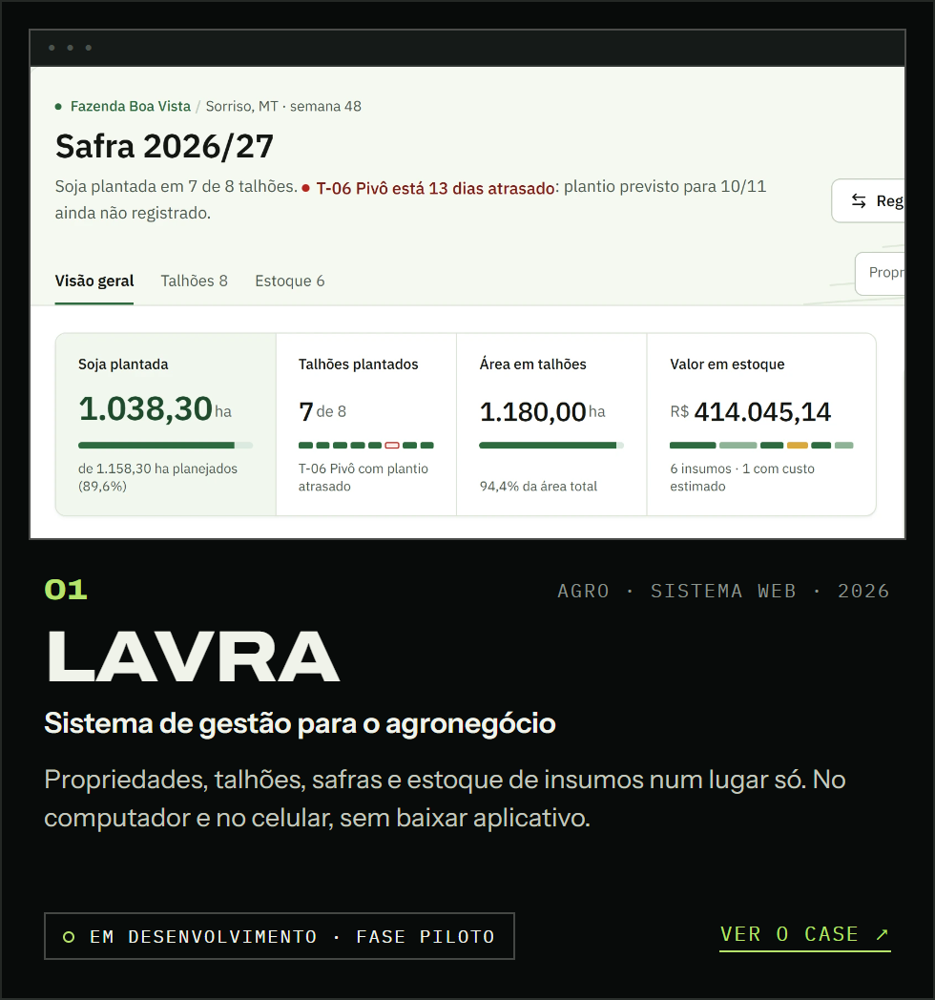</a> <a href="https://benatti-creator.github.io/terra-codigo/projetos/decoder/">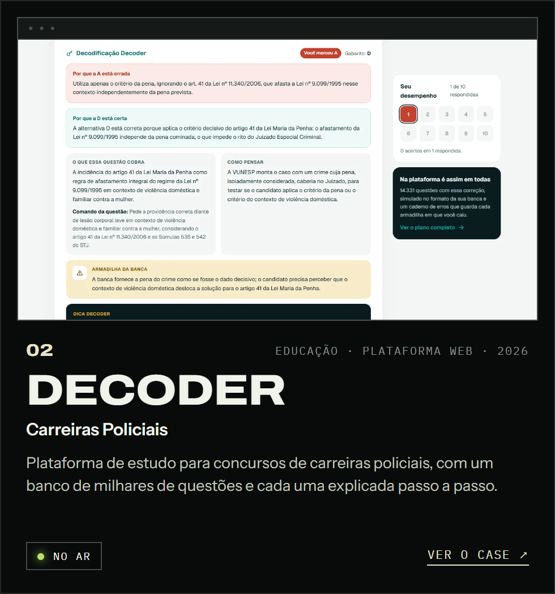</a>

<a href="https://benatti-creator.github.io/terra-codigo/projetos/sentinela/#laboratorio">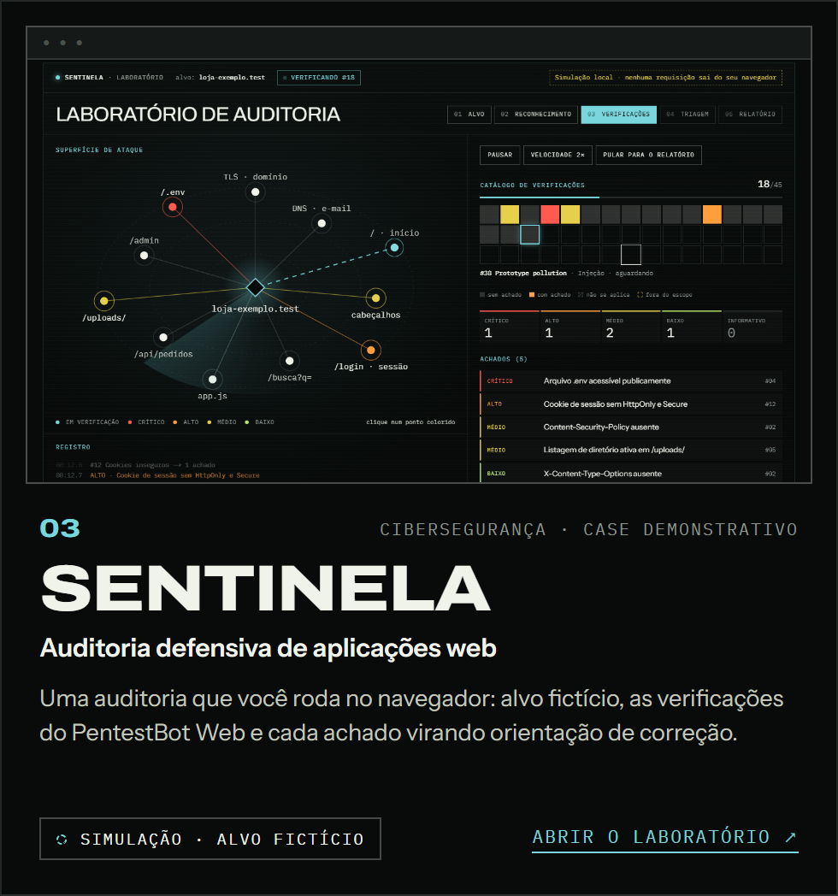</a> <a href="https://benatti-creator.github.io/terra-codigo/projetos/cris-assis/">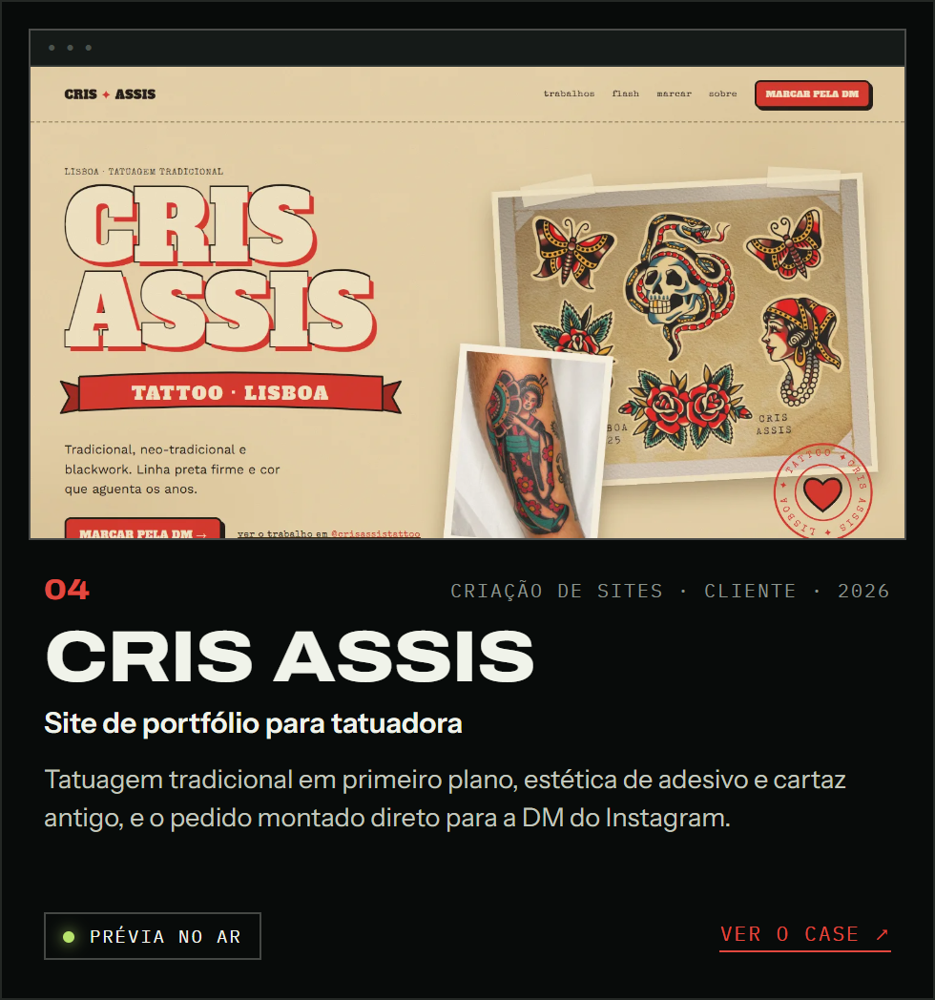</a>

Outros sites: <a href="https://benatti-creator.github.io/previas/iplanet-store/">iPlanet Store</a> · <a href="https://benatti-creator.github.io/previas/isabella-ribeiro-biomedica/">Isabella Ribeiro</a> · <a href="https://benatti-creator.github.io/previas/jatahy-dreams-eventos/">Jatahy Dreams Eventos</a>

 

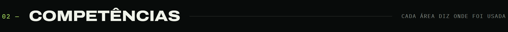

  

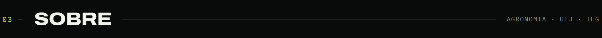

  

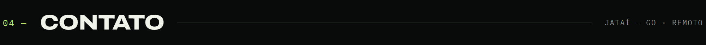

<a href="https://benatti-creator.github.io/terra-codigo/#contato">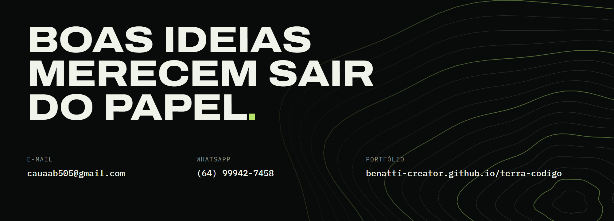</a>

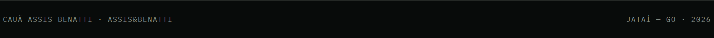
